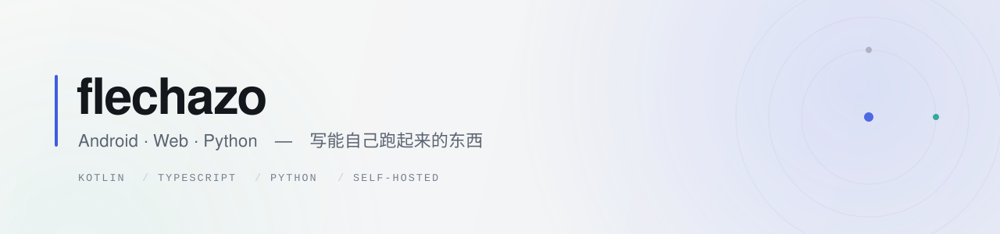

<picture>
  <source media="(prefers-color-scheme: dark)" srcset="./assets/banner-dark.svg">
  <source media="(prefers-color-scheme: light)" srcset="./assets/banner-light.svg">
  
</picture>

  
  
  

写能自己跑起来的东西。折腾自托管，用 AI 开发小工具。

## 在做的事

- **COC 战报工具** — 《部落冲突》部落战/联赛数据管理，Android 原生 + Web 双端，数据放在自己服务器
- **自建博客** — Next.js 16 + SQLite，域名、部署、备份、监控全链路自己跑

## 精选项目

| 项目 | 说明 | 技术 |
| --- | --- | --- |
| **[tools](https://github.com/yghdev/tools)** | 27 个高频小工具的 Android 工具箱，无广告无追踪，release 约 2 MB | Kotlin · Compose · Room |
| **[coc-war-tool](https://github.com/yghdev/coc-war-tool)** | 部落战 / 联赛 CSV 导入、进攻统计、花名册管理，264 个单元测试 | Kotlin · Compose · Room |
| **[coc-tool-web](https://github.com/yghdev/coc-tool-web)** | 同一套业务的 Web 版，服务端统一存数据，多设备共用 · [在线试试](https://coc.yghsite.cn) | React · TS · Node · Postgres |
| **[blog-next](https://github.com/yghdev/blog-next)** | 自建博客，SSR + SQLite，自带编辑器、图片上传、评论审核、TOTP · [线上](https://blog.yghsite.cn) | Next.js 16 · SQLite |
| **[image-processing-tool](https://github.com/yghdev/image-processing-tool)** | 变换 / 增强 / 边缘检测 / JPEG 压缩，核心算法全部 NumPy 手写 · [在线试试](https://image-processing-tool.streamlit.app) | Python · NumPy · Streamlit |
| **[puzzle-game](https://github.com/yghdev/puzzle-game)** | 拼图小游戏，学习期间把 Java 基础过了一遍 | Java · Swing |

## 手上常用的

  
  
  
  
  
  
  
  
  
  

## 三条偏好

1. **本地优先** — 能离线就不联网，数据能自己拿着就自己拿着。
2. **能自托管就自托管** — 域名、部署、备份、监控，尽量不让别人替我保管。
3. **AI 结对，人拍板** — 让 AI 写样板、查边界、补测试；架构和取舍自己负责。

---

  <a href="https://blog.yghsite.cn">博客</a> ·
  <a href="https://github.com/yghdev?tab=repositories">全部仓库</a> ·
  <a href="mailto:flechazoyang@gmail.com">邮件</a>

